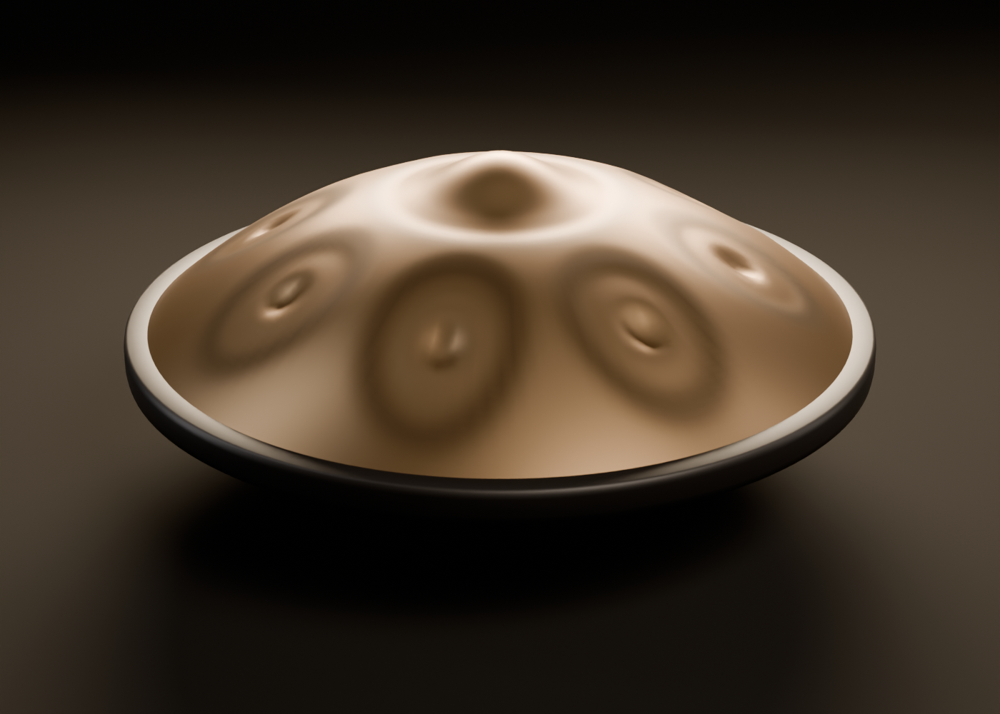

# Handpan 3D: web-ready hang drum model

مدل سه‌بعدی و بهینهٔ ساز هنگ‌درام (هندپن) با خروجی GLB برای وب. ساخته‌شده با اسکریپت پایتون در Blender.



**Live 3D viewer:** https://kiarash98e.github.io/handpan-3d/ (served by GitHub Pages from `docs/`)


A parametric concept model of a 9-note handpan (a ding plus 8 tone fields), built by script and exported as a Draco GLB.

**Review status:** not yet reviewed by a person. The dimensions are typical values (assumptions), not measurements of a real instrument.

## Files

| File | What it is |
|---|---|
| `scripts/build_handpan.py` | The parametric build: geometry, materials, GLB export, preview renders and `.blend` |
| `scripts/verify_handpan_glb.py` | Reopens the GLB in an empty Blender scene and checks it |
| `docs/handpan.glb` | The model for the web: 2 meshes, 2 materials, Draco compression, **53.8 KB** (55,140 bytes) |
| `docs/index.html` | A minimal three.js 0.160 viewer: orbit, zoom, a reset button, studio lighting with soft shadows, loading and error states |
| `renders/handpan_preview.png`, `renders/handpan_preview_top.png` | Cycles preview renders, 1400×1000, 96 samples, denoised: a 3/4 hero view and a top view |
| `blender/handpan.blend` | The built scene, including the preview studio (floor, lights, camera) |
| `reports/build_report.json` | Dimensions, triangle counts, tone-field layout and all parameters as measured by the build |
| `reports/verify_report.json` | The result of reopening the GLB in a fresh Blender scene |

## Dimensions (assumed, metres)

| | |
|---|---|
| Overall diameter (outside the rim band) | 0.530 |
| Total height (base to the top of the ding) | 0.240 (0.2398 measured) |
| Shell seam height above the base | 0.108 |
| Ding diameter / rise | 0.124 / 0.018 |
| Gu port diameter | 0.124, with a 20 mm lip turned inward |
| Tone fields | 8 ellipses, semi-axes 58×45 mm down to 44×34 mm, zig-zag order starting at the front (−Y) |

- Units are metres and Z is up; glTF converts to Y-up on export.
- The origin is at the base centre, and the lowest point of the instrument sits at z = 0.
- Transforms are applied (location 0, scale 1).

## Optimisation

- **Triangle budget:** under 30,000. The model has **25,776**: the body has 23,472 and the rim band has 2,304.
- **Mesh:** one polar grid (144 segments × 56 top rings + 22 bottom rings + the Gu lip), all quads and a centre fan, with no hidden inner faces.
- **Normals:** the mesh is smooth shaded, with sharp edges from angle at 48° on the body (the seam and the Gu lip) and 60° on the band.
- **Draco settings:** level 6, position 14 bits, normal 10 bits, colour 10 bits.

## Materials (glTF PBR, no textures)

- **`MAT_Handpan_NitridedSteel`:** the base colour comes from the vertex colours (`COLOR_0`). They hold a dark bronze-brown nitrided-steel tone, darker tone-field borders and a darker ring round the ding. Metallic is 0.88, roughness is 0.40, and the material is `doubleSided`, so the inside shows through the Gu.
- **`MAT_Handpan_RimBand`:** blackened steel, with metallic 0.75 and roughness 0.48.

No procedural textures are used, so nothing is lost on export.

## Lighting

The preview studio exists only for the renders and is not exported.

- **Backdrop:** a near-black, near-matte curved cyclorama. It has no horizon line and does not pick up glossy spill from the lights.
- **Key:** a warm softbox at the front right, focused with a 70° spread. It casts the shadow.
- **Reflectors:** an overhead softbox and two tall strip lights, left (cool) and right. They are invisible to diffuse rays, so they draw long highlights on the metal without lighting up the backdrop.
- **Rim:** a warm strip behind the instrument outlines the shoulder and the rim band.
- **Environment:** Blender's bundled `studio.exr` at a low 0.06 strength, used only for reflections.
- **Colour management:** AgX with the Punchy look and an exposure of −1.3, so the bronze highlights do not clip to cream.

The web viewer copies the same layout. It builds an HDR environment from the same softbox panels, and adds a directional key light with soft shadows (PCF, 2048 px) on a shadow-only floor, a warm rim light and a dark radial backdrop.

## Regenerate

Run these from the repository root. You need Blender 5.3 (adjust the path to your install). Outputs go to `output/HANDPAN/` unless you pass `--out`; copy the GLB into `docs/` to update the viewer.

```bash
"C:/Program Files/Blender Foundation/Blender 5.3/blender.exe" --background --factory-startup --python scripts/build_handpan.py
```

```bash
"C:/Program Files/Blender Foundation/Blender 5.3/blender.exe" --background --factory-startup --python scripts/verify_handpan_glb.py
```

- **Build options:** `-- --no-render` skips the preview (the two renders take about a minute on an RTX 4050 with OptiX), `--samples N` sets the render samples and `--out DIR` sets the output folder.
- **Parameters:** sizes, tessellation and colours are in the `P` dictionary at the top of `build_handpan.py`.
- **Verification:** the verify script exits with code 1 if a check fails, either the size or triangle limits, Draco, the vertex colours or the material names.

## View in the browser

The viewer must be served over HTTP, because opening the file directly is blocked by the browser:

```bash
uv run python -m http.server 8811 --bind 127.0.0.1
```

Run this inside `docs/`, then open http://127.0.0.1:8811/. The viewer loads three.js and the Draco decoder from jsDelivr, so it needs an internet connection.

## Verification done (2026-11-17)

- **Reimport:** the GLB was reopened in Blender 5.3. It measures 0.530 × 0.530 × 0.2398 m with min z = 0, and has 25,776 triangles. Both materials survived with their metallic and roughness values. The body's base colour is linked to the `Color` attribute, and Draco is listed in `extensionsRequired`. All checks passed (`reports/verify_report.json`).
- **Browser:** the viewer was checked in the built-in browser at desktop width and at 375 × 812. It loaded with no console errors, the underside and Gu were visible by orbiting, there was no horizontal scroll, and the error state appeared when the model was missing.

## Limitations

- **Visual model only:** this is not acoustically tuned. The tone-field sizes and placement are aesthetic, not pitches.
- **Surface detail:** there is no hammer-texture normal map, and the surface is smooth. A baked normal map would add realism but cost file size.
- **Thickness:** the shell is a single surface with no thickness. The Gu lip hides this from normal viewing angles.
